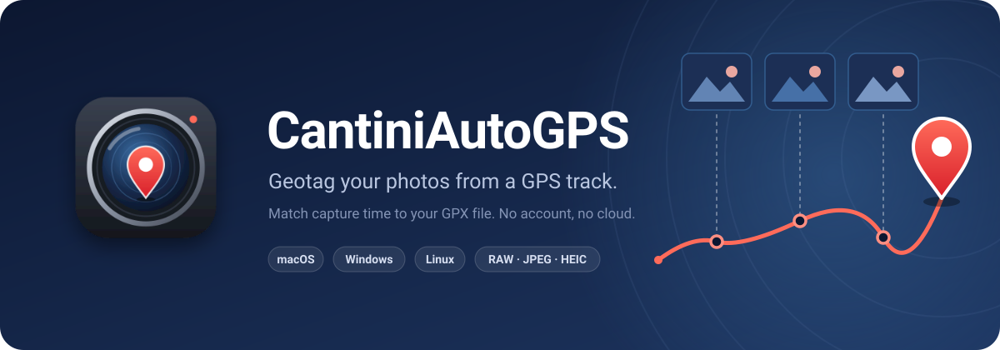
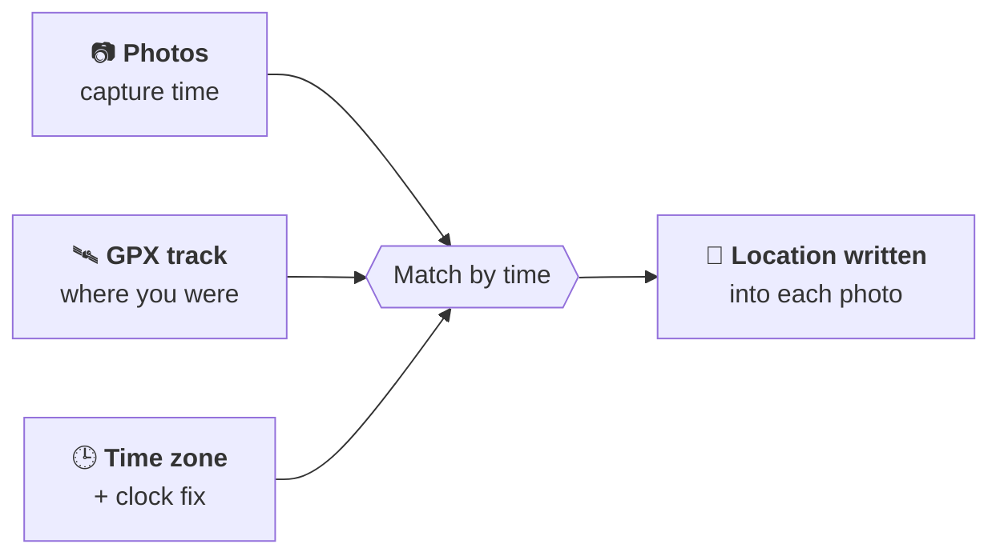
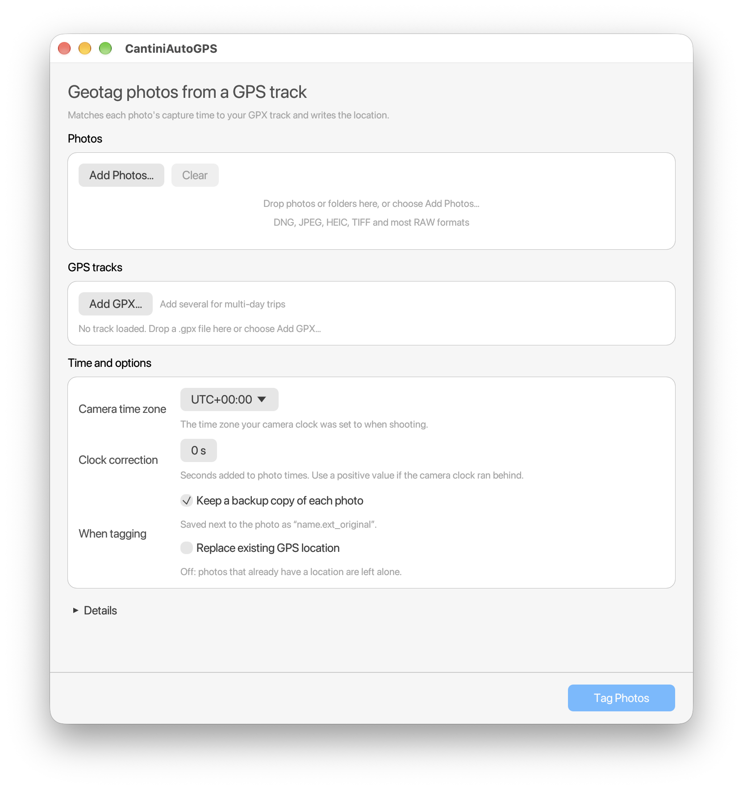

<div align="center">



<br>

[](https://github.com/rmcantini/CantiniAutoGPS/releases/latest)
[](https://github.com/rmcantini/CantiniAutoGPS/actions/workflows/build.yml)
[](LICENSE)
[](https://www.rust-lang.org)

**Drop in your photos and a GPX file from your phone, watch or GPS logger.<br>CantiniAutoGPS matches each photo's capture time to where you were, and writes the location into the file.**

<br>

[](https://github.com/rmcantini/CantiniAutoGPS/releases/latest)
&nbsp;
[](https://github.com/rmcantini/CantiniAutoGPS/releases/latest)
&nbsp;
[](https://github.com/rmcantini/CantiniAutoGPS/releases/latest)

<sub>Free and open source. ExifTool is bundled, so there is nothing else to install.</sub>

<br>

[Features](#-features) &nbsp;·&nbsp; [How it works](#-how-it-works) &nbsp;·&nbsp; [Quick start](#-quick-start) &nbsp;·&nbsp; [Install](#-install) &nbsp;·&nbsp; [Tips](#-tips) &nbsp;·&nbsp; [Build](#-build-from-source) &nbsp;·&nbsp; [License](#-license)

</div>

<br>

## ✨ Features

<table>
  <tr>
    <td width="33%" valign="top">
      <h4>📸 Your formats</h4>
      DNG, CR2, CR3, NEF, ARW, ORF, RAF, RW2, plus JPEG, HEIC and TIFF.
    </td>
    <td width="33%" valign="top">
      <h4>🖱️ Drag and drop</h4>
      Drop photos, whole folders and GPX files onto the window, or use the Add buttons.
    </td>
    <td width="33%" valign="top">
      <h4>🗺️ Multi-day tracks</h4>
      Load several GPX files at once, handy for longer trips.
    </td>
  </tr>
  <tr>
    <td valign="top">
      <h4>✅ Check before you tag</h4>
      See <em>"37 of 40 photos fall within the track"</em> and both time spans, so a wrong time zone is obvious before anything is written.
    </td>
    <td valign="top">
      <h4>🕒 Time zone and clock</h4>
      The camera time zone is detected from your photos. If the camera clock was off, correct it in seconds.
    </td>
    <td valign="top">
      <h4>🛡️ Safe by default</h4>
      Keeps an untouched backup of every photo and leaves photos that already have a location alone.
    </td>
  </tr>
  <tr>
    <td valign="top">
      <h4>📋 Clear results</h4>
      Every photo shows whether it was tagged, skipped, or had no matching point, with a summary at the end.
    </td>
    <td valign="top">
      <h4>⏱️ Progress and Cancel</h4>
      Watch it work through a big batch, and stop whenever you like.
    </td>
    <td valign="top">
      <h4>🌗 Light and dark</h4>
      Follows your system appearance and remembers your settings.
    </td>
  </tr>
</table>

<br>

## 🧭 How it works



For each photo, CantiniAutoGPS runs [ExifTool](https://exiftool.org) with your GPX track and the camera time zone, and ExifTool writes the matching GPS coordinates into the file. The app reads capture times first so it can show you the coverage check, then tags photos one at a time so it can show progress and let you cancel.

<br>

## 🚀 Quick start

<table>
  <tr>
    <td align="center" valign="top" width="20%"><h3>①</h3><b>Add photos</b><br><sub>Drag in photos or folders, or click <em>Add Photos…</em></sub></td>
    <td align="center" valign="top" width="20%"><h3>②</h3><b>Add a track</b><br><sub>Drop your <code>.gpx</code> file(s), or click <em>Add GPX…</em></sub></td>
    <td align="center" valign="top" width="20%"><h3>③</h3><b>Check the time</b><br><sub>Confirm the camera time zone under <em>Time and options</em></sub></td>
    <td align="center" valign="top" width="20%"><h3>④</h3><b>Look at coverage</b><br><sub>Aim for <em>"all photos fall within the track"</em></sub></td>
    <td align="center" valign="top" width="20%"><h3>⑤</h3><b>Tag Photos</b><br><sub>Click once. <em>Details</em> at the bottom has the full log</sub></td>
  </tr>
</table>

<p align="center">
  <picture>
    <source media="(prefers-color-scheme: dark)" srcset="docs/screenshot-dark.png">
    
  </picture>
  <br>
  <sub>The main window. It follows your system's light or dark appearance.</sub>
</p>

<br>

## 📦 Install

Pick your system. Each section is a one-time setup.

<details>
<summary><b>&nbsp;macOS</b> &nbsp;<sub>Apple silicon (M1 or later)</sub></summary>

<br>

1. Download `CantiniAutoGPS-<version>-macOS-arm64.dmg` from the [latest release](https://github.com/rmcantini/CantiniAutoGPS/releases/latest).
2. Open the DMG and drag **CantiniAutoGPS** into your **Applications** folder.
3. Open it for the first time using the steps below.

> [!NOTE]
> CantiniAutoGPS is free and open source and is **not signed with a paid Apple Developer ID or notarized by Apple**. macOS therefore blocks it the first time with a message such as *"CantiniAutoGPS can't be opened because Apple cannot check it for malicious software."* This is expected, and you only have to do this once.

**macOS 15 Sequoia and later**

1. Try to open CantiniAutoGPS from Applications. Click **Done** (not "Move to Bin") on the warning.
2. Open **System Settings → Privacy & Security** and scroll down to the **Security** section.
3. Next to *"CantiniAutoGPS" was blocked to protect your Mac*, click **Open Anyway**.
4. Confirm with your password or Touch ID, then click **Open**.

**macOS 14 Sonoma and earlier**

Right-click (or Control-click) the app, choose **Open**, then click **Open** in the dialog.

**Prefer Terminal?** This removes the "downloaded from the internet" flag:

```bash
xattr -dr com.apple.quarantine /Applications/CantiniAutoGPS.app
```

The app uses the Perl that ships with macOS to run the bundled ExifTool.

</details>

<details>
<summary><b>&nbsp;Windows</b> &nbsp;<sub>Windows 10 or 11, 64-bit</sub></summary>

<br>

1. Download `CantiniAutoGPS-<version>-windows-x64.zip` from the [latest release](https://github.com/rmcantini/CantiniAutoGPS/releases/latest).
2. Right-click the zip and choose **Extract All…**. Run the app from the extracted folder, not from inside the zip, and keep the folder together: `CantiniAutoGPS.exe` needs `exiftool.exe` and the `exiftool_files` folder next to it.
3. Double-click `CantiniAutoGPS.exe`.

> [!NOTE]
> The app is **not code-signed**, so Windows SmartScreen may show *"Windows protected your PC"*. Click **More info**, then **Run anyway**. You only need to do this once. Alternatively, right-click the downloaded zip, choose **Properties**, tick **Unblock**, and extract it afterwards.

</details>

<details>
<summary><b>&nbsp;Linux</b> &nbsp;<sub>AppImage, x86_64, glibc 2.35+</sub></summary>

<br>

**Requirements:** 64-bit Intel/AMD, a desktop with OpenGL, and a distribution with glibc 2.35 or newer (for example Ubuntu 22.04+, Debian 12+, Fedora 36+, Arch). Perl must be installed, which it is by default on virtually all desktop distributions. File dialogs use `xdg-desktop-portal`, which every major desktop provides.

1. Download `CantiniAutoGPS-<version>-linux-x86_64.AppImage` from the [latest release](https://github.com/rmcantini/CantiniAutoGPS/releases/latest).
2. Make it executable and run it:

```bash
chmod +x CantiniAutoGPS-*-linux-x86_64.AppImage
./CantiniAutoGPS-*-linux-x86_64.AppImage
```

> [!TIP]
> AppImages need FUSE 2. If you see an error about `libfuse.so.2` (common on Ubuntu 22.04 and newer), either install it (`sudo apt install libfuse2`; on Ubuntu 24.04 the package is `libfuse2t64`) or run the app without FUSE:
>
> ```bash
> ./CantiniAutoGPS-*-linux-x86_64.AppImage --appimage-extract-and-run
> ```

The Linux build is smoke-tested on a virtual display in CI. Please [report any issues](https://github.com/rmcantini/CantiniAutoGPS/issues) from real desktops.

</details>

Would rather not trust a binary? [Build it yourself](#-build-from-source).

<br>

## 💡 Tips

> [!TIP]
> **Time zone is the usual culprit.** Cameras store local time without a zone. If few photos match, the time zone is almost always the reason.

> [!TIP]
> **Camera clock off?** Use *Clock correction*. If the camera clock ran behind, enter a positive number of seconds; if it ran ahead, enter a negative one.

> [!NOTE]
> **Track points far apart?** Locations are interpolated between track points, but only when the points are close enough in time. Otherwise the nearest point is used.

> [!WARNING]
> **Photos are modified in place.** Keep *Keep a backup copy of each photo* ticked unless you have your own backups. Re-running on a photo that already has a backup keeps the first backup, so the `_original` file is always your untouched photo. Delete the `_original` files once you are happy with the result.

<br>

## 🛠️ Build from source

You need [Rust](https://rustup.rs). From the project folder:

```bash
cargo run --release     # run the app
cargo test              # run the tests
```

<details>
<summary><b>Packaging, ExifTool lookup and CI</b></summary>

<br>

To build the macOS app bundle and DMG, install [cargo-bundle](https://github.com/burtonageo/cargo-bundle) and run:

```bash
cargo install cargo-bundle
cargo bundle --release
```

The result is in `target/release/bundle/`.

**Where the app finds ExifTool**, in this order:

1. The bundled copy: `vendor/exiftool/` on macOS and Linux, or `exiftool.exe` next to the app on Windows (download it from [exiftool.org](https://exiftool.org)).
2. An ExifTool installed on your system (for example `brew install exiftool`).

Run `cantini_auto_gps --check-exiftool` to see which one is being used.

**Releases** are built by GitHub Actions (`.github/workflows/build.yml`): every push builds and tests macOS, Windows and Linux, and pushing a `v*` tag publishes the macOS DMG, Windows zip and Linux AppImage.

</details>

<br>

## 📄 License

CantiniAutoGPS is released under the **[MIT License](LICENSE)**. It bundles and uses other software under their own licenses:

| Component | License | Details |
|---|---|---|
| **[ExifTool](https://exiftool.org)** by Phil Harvey, bundled unmodified | Same terms as Perl (Artistic License or GPL), redistributed under the Artistic License | [`vendor/exiftool/LICENSE-Artistic.txt`](vendor/exiftool/LICENSE-Artistic.txt) |
| **Rust crates** (egui/eframe, rfd, image and their dependencies) | MIT, Apache-2.0, BSD, Zlib, Unicode and similar permissive licenses | [`THIRD_PARTY_LICENSES.md`](THIRD_PARTY_LICENSES.md), also included inside the app bundle |
| **Fonts** | The interface uses your system font at runtime (San Francisco on macOS, Segoe UI on Windows), which is not redistributed. egui's embedded fonts are the fallback | Licenses in [`THIRD_PARTY_LICENSES.md`](THIRD_PARTY_LICENSES.md) |

<br>

<div align="center">

<sub>Thanks to Phil Harvey for ExifTool, which does the hard part, and to the egui project for the UI toolkit.</sub>

</div>
